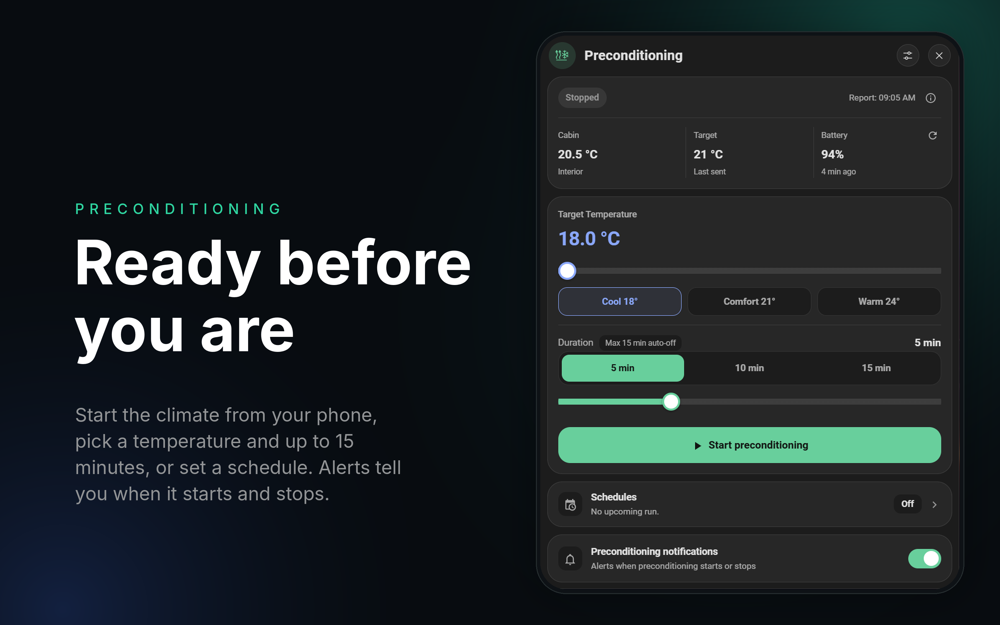

# Preconditioning

[README](../README.md) · [User guide](USAGE.md) · [All settings](SETTINGS.md) · [Notifications](NOTIFICATIONS.md) · [Troubleshooting](TROUBLESHOOTING.md)

Preconditioning turns the car’s climate on remotely, so the cabin is comfortable when you get in. Start it by hand from the card, or let a schedule do it. Companion checks that the car really did what was asked, tells you the result and keeps a record of every step.

The car allows remote climate for **15 minutes at most**, and it switches itself off after that. Companion never tries to extend it. Remaining and end times are estimates, because the car does not report how long the climate has been running.

Remote climate works only when the car is **parked and switched off**.

## Screenshots

## Where to find it

- **Vehicle card:** open **Preconditioning** in the **More** panel (or in the main button row if you moved it there). A small panel opens with the temperature, the duration, Start and Stop. **More settings in the Companion dashboard** opens the full page.
- **Companion dashboard → Preconditioning:** the full page with your setup in short, manual control, schedules, battery protection, notifications and diagnostics.
- **Companion dashboard → Notifications → Preconditioning:** the same notification choices as on the other pages.

The button on the card is coloured while Companion’s own preconditioning is running. A small pulsing dot shows that a schedule is set.

Everything is saved in one place. A choice you change on the card, on the Preconditioning page or on the Notifications page is the same choice everywhere.

## Start and stop by hand

1. Open **Preconditioning** (card or dashboard).
2. Move the **Temperature** bar (18–32 °C, in 0.5 °C steps) and the **Duration** bar (1–15 minutes).
   In the card popup you can also use the temperature slider, the **Cool**, **Comfort** and **Warm** quick choices, and the **5**, **10** and **15** minute buttons. The refresh button asks the car for fresh data and keeps spinning until the new report arrives. The sliders icon at the top opens the Preconditioning page of the Companion dashboard, and tapping the notifications text opens it at the notification settings (administrators only).
3. Press **Start preconditioning**. While it runs, the button is replaced by a countdown with a **Stop** button.
4. Watch the status chip: **Starting**, **Verifying**, then **Active**. Press **Stop preconditioning** at any time to end it early.

The last temperature and duration you choose are remembered for next time and for new schedules. There is no separate “default” setting to maintain.

If the climate is already on, Companion changes nothing and says so. If someone starts the climate in the Deepal app or in the car, Companion does not stop it for you.

## What happens on every Start and Stop

1. Companion asks the car for fresh data and waits briefly for a newer report.
2. It checks the climate, the battery and the car’s availability.
3. It sends the command.
4. It waits for the car to **report** the change. A successful request alone is never treated as success. A few seconds after the command, and again while waiting, Companion asks the car for a fresh report, so confirmation does not depend on the car’s normal update interval.
5. It asks for fresh data once more afterwards.

If the car does not confirm, Companion tries again, up to the number of attempts you set. Before each retry it refreshes the car’s data and checks again, and if the car already reached the wanted state it confirms instead of sending the command a second time. The same checks run before each retry. If the result still cannot be confirmed, the status shows **Failed** or **Unknown** and you get a message.

## Schedules

Open **Preconditioning → Schedules → Create schedule**.

- **Repeat:** Once, Daily, Mon–Fri or Custom days.
- **Mode:**
  - **Start at** turns the climate on exactly at the time you choose.
  - **Ready by** starts earlier by the preparation time, so the cabin is ready at your time. The cabin may not reach the target by then.
- **Date** (for Once), **Start time** or **Ready time**, **Duration** or **Preparation time** (1–15 minutes) and **Temperature**.
- An optional **Name**.

Turn each schedule on or off with its switch. A schedule set to **Once** switches itself off after it runs. You can keep up to 20 schedules.

The main switch **Scheduled preconditioning** (under **General**) is **off by default**. While it is off, no schedule runs, and manual Start still works.

Times follow the Home Assistant time zone, including daylight-saving changes and schedules that cross midnight.

If Home Assistant was not running at the start time, Companion starts the schedule only if it is less than five minutes late. Otherwise it records the run as missed and tells you. After a restart, Companion never repeats an old Start.

A schedule is skipped, and recorded, when the climate is already on, another session is running, or battery protection blocks it.

## Battery protection

Open **Preconditioning → Battery protection**. It is off by default.

- **Minimum battery:** 10–50 % in 5 % steps. This is your own choice, not a manufacturer recommendation. It uses the traction battery level, not fuel or the 12 V battery.
- **Block START at or below the minimum:** Start is refused at or below the minimum, and also when the battery level is unavailable or still not current after the refresh.
- **Request STOP at the minimum:** a running session is stopped when the battery drops to the minimum. It can act later than the exact moment if reports are delayed.
- **Apply while charging:** on by default and recommended. Turn it off to let a plugged-in, charging car run below the minimum.

The car often sleeps deeply, so its last battery reading may be 30–60 minutes old. That is normal: before every Start, manual or scheduled, Companion asks the car for fresh data and checks the new reading. Only if the car still does not answer is the Start blocked.

## Notifications

Open **Preconditioning → Notifications** (or **Notifications → Preconditioning**).

- **Preconditioning notifications:** the switch for phone messages about preconditioning.
- **Phones:** choose the phones as pills, the same way as on the Notifications page. The list is **shared with Live climate**: changing the phones here also changes them in **Notifications → Live climate**.
- **Events:** choose which events send a message, each with a short explanation. By default you get results and problems only: confirmed on and off, failures, unknown state, schedule results, a session ended by the car and battery protection. Requested starts and stops and retry warnings are off.
- **Send test notification:** sends an example message to the chosen phones. “Sent to 1 of 1 phones” means Home Assistant accepted it; arrival on the phone is not confirmed.

A message with a Stop button appears while the climate is running. The running status on the lock screen comes from Live climate, so you never get two climate notifications.

Turning notifications off never turns off verification, battery protection or the activity log. The global **Notifications** switch and the phone’s notification permission still apply.

Messages follow the Home Assistant language (English, Italian, Spanish, German or Greek).

## If someone drives the car

If the car is switched on or driven, Deepal does not allow remote climate and answers with an error. Companion explains this in plain words, does **not** retry, and hands the climate over to the driver: it stops managing the session and sends no more commands. It also hands over when the odometer shows the car has moved.

## Advanced: retries and checks

Open **General → Advanced: retries and checks**.

| Setting | Range | Default | What it does |
| --- | --- | --- | --- |
| Attempts | 1–3 | 3 | How many times a Start or Stop is sent in total. The car is checked again before each retry. |
| Wait between attempts | 10–120 s | 30 s | Pause before trying again, to respect the Deepal limit. |
| Wait for the car to answer | 30–180 s | 90 s | If the car does not report the change within this time, the attempt counts as not confirmed. |

## Activity and diagnostics

Every action is written to **Notifications → Recent activity** and to the Home Assistant log. The **Diagnostics** box on the Preconditioning page shows the current operation, the last confirmed state, the last successful Start and Stop, the last failure, the number of retries, and the session history.

The session history keeps the last 30 days and removes older entries automatically. When it grows long it scrolls inside its own box. Administrators can empty it at any time with **Clear history** (after a confirmation); this does not touch Recent activity in Notifications. Stop entries give the reason in words, for example “Planned duration reached”, “Stopped by battery protection” or “Stopped by you”.

## Good to know

- Preconditioning needs the **Deepal Alternative** climate entity, its **Refresh vehicle data** button and its battery level sensor.
- Companion sends climate commands only when you press Start or Stop, when a schedule you created is due, or when battery protection stops a session you started.
- Restart Home Assistant after updating, because preconditioning runs in the backend.

## Notification language

The language of every notification is set once at the top of **Notifications** (see [NOTIFICATIONS.md](NOTIFICATIONS.md)). Preconditioning messages follow it.

## Confirmations

Deleting a schedule or clearing the session history asks for confirmation in a popup.
